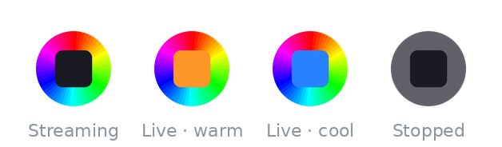
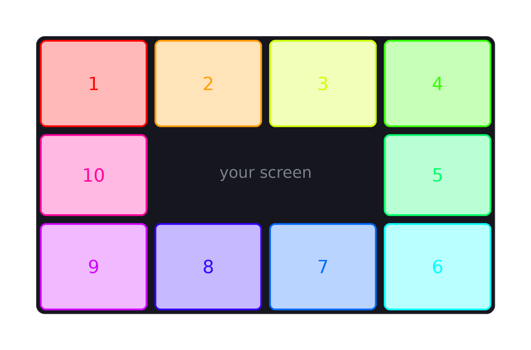

# GoveeDreamView

Windows tray utility that syncs a Govee Wi-Fi LED strip to your screen — a lean,
native reimplementation of the "Movie / Gaming DreamView" ambient light from the
Govee Desktop app. Captures the screen, averages it into edge colour zones, and
streams them to the strip over the local network ~30×/s. The tray icon is a live
colour wheel that shows the current on-screen colour; it can turn the strip off
when you lock Windows and colour-calibrate against your wall with your phone.
Single sub-100 KB exe, nothing to install, no cloud, no account, no telemetry.

## Screenshots

Animated tray icon — a colour-wheel ring around a screen that tints to the current
dominant on-screen colour while streaming, and greys out when stopped:



How the screen maps to the strip: the frame is averaged into a clockwise perimeter
of colour zones, each streamed to one DreamView segment:



## How it works

Govee's DreamView is the **"razer" mode** of the Govee LAN API. Everything is UDP
on the local network — no internet round-trip:

| Step | Transport | Payload |
|------|-----------|---------|
| Discover | multicast `239.255.255.250:4001`, reply on `:4002` | `{"cmd":"scan"}` → reply has `ip`, `sku` |
| Power / brightness | UDP `<device>:4003` | `{"cmd":"turn","value":1}` · `{"cmd":"brightness","value":100}` |
| Enable stream | UDP `:4003` | `{"cmd":"razer","pt":"uwABsQEK"}` (= `BB 00 01 B1 01 0A`) |
| **Stream colours** | UDP `:4003` | `{"cmd":"razer","pt":"<base64 packet>"}` |
| Disable stream | UDP `:4003` | `{"cmd":"razer","pt":"uwABsQAL"}` (= `BB 00 01 B1 00 0B`) |

The `<base64>` colour payload is a raw byte packet:

```
BB 00 <len> B0 <stretch> <N> <R G B> x N <XOR-checksum>
 |  |    |   |     |       |   \___ N colour triples ___/   \_ XOR of all prior bytes
 |  |    |   |     |       └─ segment/zone count
 |  |    |   |     └─ 0x00 = per-segment, 0x01 = stretch N colours across all LEDs
 |  |    |   └─ 0xB0 constant
 |  |    └─ payload length = 2 + 3*N  (stretch byte + count byte + RGB bytes)
 └──┴─ 0xBB 0x00 constant
```

> **The `<len>` byte matters.** Some references hard-code it as a "header variant"
> (`0xFA`/`0x20`/`0x0E`). It isn't — it's the payload length, and `0x20` (= `2+3*10`)
> just reflects that Govee Desktop DreamView streams **10 segments**. The strip
> *silently drops* any packet whose length byte doesn't equal `2 + 3*N`, so this app
> computes it from `N`.

So the whole loop is: **capture screen → box-average into 10 perimeter zones →
gamma + saturation + colour-correction → stream the packet.** A GDI `StretchBlt`
downscales the framebuffer to a handful of pixels per tick (negligible CPU), and a
temporal EMA smooths the per-frame flicker that makes cheap ambient sync look
twitchy. The device is located by its **MAC** (resolved to the current IP via ARP
each start) so a DHCP lease change can't lose it.

Protocol credit: reverse-engineered by the
[LedFx](https://github.com/LedFx/LedFx), [egold555](https://github.com/egold555/Govee-Reverse-Engineering)
and [wez/govee2mqtt](https://github.com/wez/govee2mqtt) projects.

## Install

Needs Windows 10/11 with .NET Framework 4.x (built in). No admin.

Download `GoveeDreamView.exe` from the [latest release](../../releases/latest), or
build from source:

```cmd
build.cmd
```

Output is `bin\Release\net48\GoveeDreamView.exe` — copy it anywhere and run it. To
start at logon, drop a shortcut to it in `shell:startup`.

Your strip must support **DreamView / Razer**, be on Wi-Fi, and have **LAN Control
enabled** (Govee Home app → device → settings → *LAN Control*).

## Run

Double-click the exe. A tray icon appears and streaming auto-starts — it discovers
the device on first launch and remembers it. Right-click the icon for the menu.

## Tray menu

- **Start / Stop** — toggle streaming (also double-click the icon).
- **Pause when locked** — turn the strip off on workstation lock, back on at unlock.
- **Settings** — live colour tuning, applied instantly and saved:
  - *Brightness* (25/50/75/100) — device master brightness.
  - *Gamma* (1.8/2.2/2.6/3.2) — higher = deeper blacks but dimmer mids; the main
    brightness lever once master brightness is maxed.
  - *Saturation* (1.0/1.25/1.5/1.75) — colour vividness.
- **Reload / Edit config** — reload or open `config.ini`.
- **Rediscover device** — re-scan the LAN for the strip.
- **Calibrate colours** — phone-camera colour calibration (below).
- **Exit**.

## Configuration

A `config.ini` is created next to the exe on first run. Edit it, then tray →
*Reload config* (most colour keys are also on the Settings menu).

| Key | Default | Meaning |
|-----|---------|---------|
| `DeviceIp` | *(blank)* | Strip IP. Blank = auto-discover and remember. |
| `DeviceMac` | *(blank)* | Fixed device MAC; resolved to the current IP each start, so DHCP changes can't lose it. |
| `Fps` | `30` | Colour frames per second. |
| `Brightness` | `100` | Device master brightness, 0–100. |
| `StretchToFit` | `false` | `true` stretches the 10 colours across all LEDs (only some devices); `false` = per-segment. |
| `Smoothing` | `0.45` | Temporal EMA. `0` = instant/jittery, `0.8` = very smooth but laggy. |
| `Saturation` | `1.25` | `>1` boosts vividness. |
| `Gamma` | `2.2` | `>1` darkens dark/mid tones; raise for deeper blacks, lower for brighter mids. |
| `MonitorIndex` | `0` | Which display to capture (0 = primary). |
| `PauseOnLock` | `false` | `true` turns the strip off while Windows is locked. |
| `Ccm` | *identity* | 3×3 colour-correction matrix, set by *Calibrate colours*. |
| `CalibPort` | `8443` | HTTPS port for the phone calibration page. |

## Calibrate colours

Wall-bounced ambient light shifts the colours you actually see. *Calibrate colours*
hosts a tiny HTTPS page, you open it on your phone and point the camera at the wall
behind the strip, and it sweeps colours to solve a 3×3 correction matrix (`Ccm`)
that makes the reflected colour match the screen. Runs entirely on your LAN.

## Files

| File | Purpose |
|------|---------|
| `Program.cs` | Tray app: menu, streaming loop, animated icon, lock handling |
| `GoveeClient.cs` | Govee LAN protocol: discover, power, stream, razer packets |
| `Net.cs` | MAC→IP resolution via an ARP sweep (DHCP-proof device locating) |
| `ScreenCapture.cs` | GDI `StretchBlt` capture + per-zone box averaging |
| `Config.cs` | Flat `key=value` config next to the exe |
| `Calibration.cs` / `CameraServer.cs` | Phone-camera colour calibration |

## Troubleshooting

- **"No Govee device found"** — confirm LAN Control is on in the Govee Home app, the
  strip is on the same subnet/Wi-Fi, then set `DeviceIp` (or `DeviceMac`) manually.
- **Strip is lit but frozen on one colour** while the tray says *Streaming* — it
  dropped out of stream mode (a power blip or another controller grabbed it). Tray →
  Stop then Start re-arms it.
- **Too dim** — brightness is already the master; the real lever is **Gamma** (lower
  it in Settings). A colour calibration also caps peak white by design.
- **Logs** — errors are written to `govee.log` next to the exe.

## Releases

Push a `v*` tag and GitHub Actions builds the exe and attaches it to a release:

```bash
git tag v1.0.0 && git push origin v1.0.0
```
